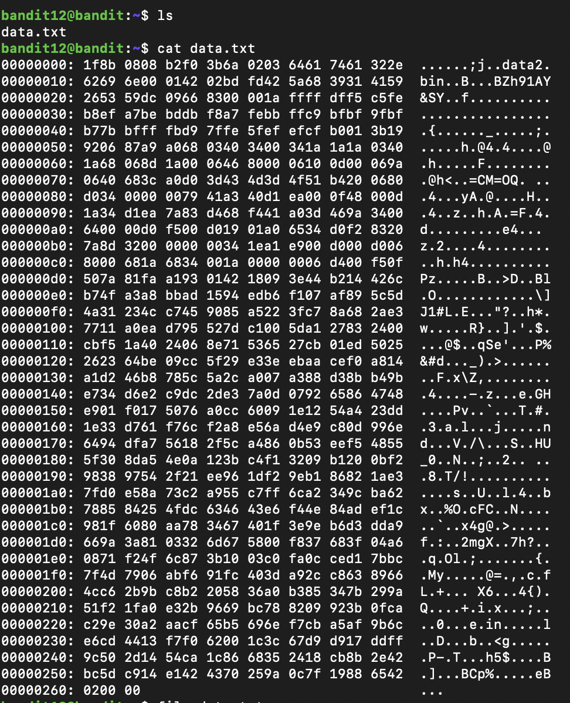

## Connexion (mot de passe GROozWPO8QyN0mGrjUkID0WCYkZiQxrN)
```
ssh -p 2220 bandit12@bandit.labs.overthewire.org
```

## Recherche du mot de passe
Ce problème un xxd


suivi d'une suite de compression de fichier gzip bzip2 tar
Le oneliner serait:
```
xxd -r data.txt > /tmp/my_temp_file.gz && gunzip -c /tmp/my_temp_file.gz > /tmp/my_temp_file.bz && bzip2 -dc /tmp/my_temp_file.bz > /tmp/my_temp_file.gz && gunzip -c /tmp/my_temp_file.gz > /tmp/my_temp_file.tar && mkdir -p /tmp/tar_extract && tar -xvf /tmp/my_temp_file.tar -C /tmp/tar_extract && tar -xvf /tmp/tar_extract/data5.bin -C /tmp/tar_extract && bzip2 -d /tmp/tar_extract/data6.bin && tar -xvf /tmp/tar_extract/data6.bin.out -C /tmp/tar_extract && mv /tmp/tar_extract/data8.bin /tmp/tar_extract/data8.bin.gz && gunzip /tmp/tar_extract/data8.bin.gz && cat /tmp/tar_extract/data8.bin
```
Si certains fichiers temporaires sous /tmp n'ont pas encore été flushé par un cronjob ca pourrait ne pas fonctionner

*Normalement, je connais pas les encodages d'avance, parfois il est nécessaire d'effectuer la commande mv pour changer l'extension des fichiers*
## Prochain mot de passe
```
qQYQiHOBPR8zR61qxYqX45quvihF2uzk
```
