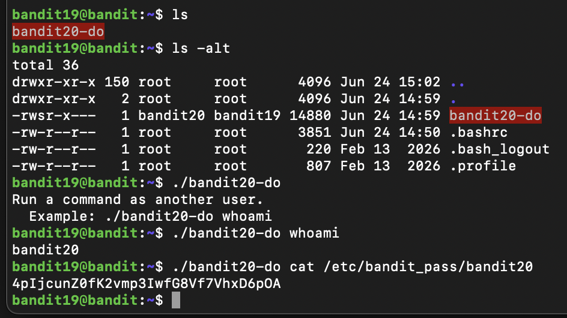

## Connexion (mot de passe KpsOfPkcP7i1FlIExk2QEjyt6dw8dxZI )
```
ssh -p 2220 bandit19@bandit.labs.overthewire.org
```

## Recherche du mot de passe
Un scrip avec un suid qui permet d'exécuter des commandes avec les droits du user bandit20.


## Prochain mot de passe
```
4pIjcunZ0fK2vmp3IwfG8Vf7VhxD6pOA
```