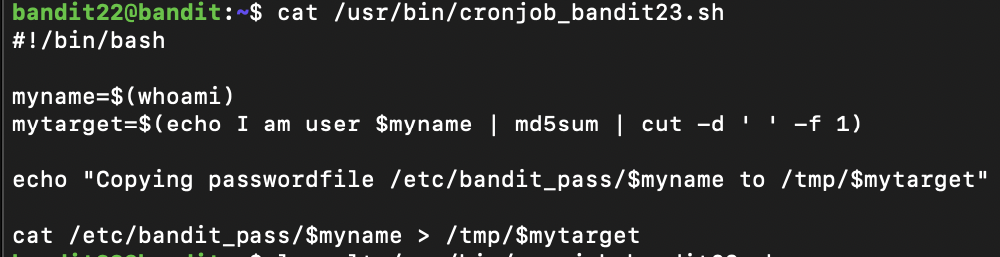

## Connexion (mot de passe RYVux2rHEm9tiXHmLFzuR7Vhx6AZQMEz)
```
ssh -p 2220 bandit22@bandit.labs.overthewire.org
```

## Recherche du mot de passe
Cette fois le script est plus complexe:


La cronjob roule régulièrement pour différent username, whoami retourne bandit22, ce qui générera un hash précis utilisé comme nom de fichier dans lequel le mot de passe sera écrit. Par contre c'est le hash de bandit23 qui m'intéresse

```
cat /tmp/$(echo "I am user bandit23" | md5sum | cut -d ' ' -f 1)
```
## Prochain mot de passe
```
gKXDTAXnIz3OBxiPjRZ2uqutUlPZrBsw
```