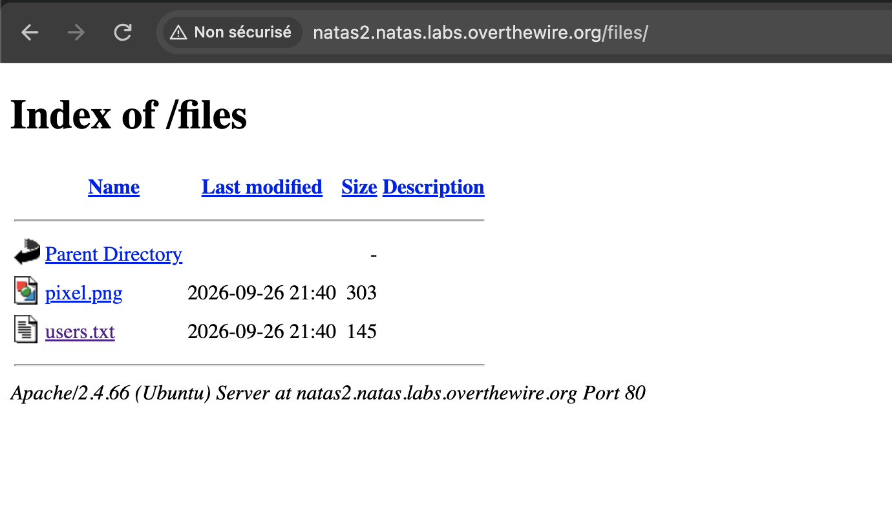

## Connexion (username=natas2 password=vsDOxoXyq3wckCP1ZmTZ71ngIA606odB)
```
http://natas2.natas.labs.overthewire.org/
```

## Recherche du mot de passe
J'ouvre le code source de la page et voit une section:
```html
There is nothing on this page

```

Or je pourrai voir dans le répertoire files si il existe autre fichier.


Le fichier users.txt contient ceci :

alice:BYNdCesZqW
bob:jw2ueICLvT
charlie:G5vCxkVV3m
natas3:K30JrSRHzjxq3paUQuwozY4MNvmNFyhI
eve:zo4mJWyNj2
mallory:9urtcpzBmH
## Prochain mot de passe
```
K30JrSRHzjxq3paUQuwozY4MNvmNFyhI
```
